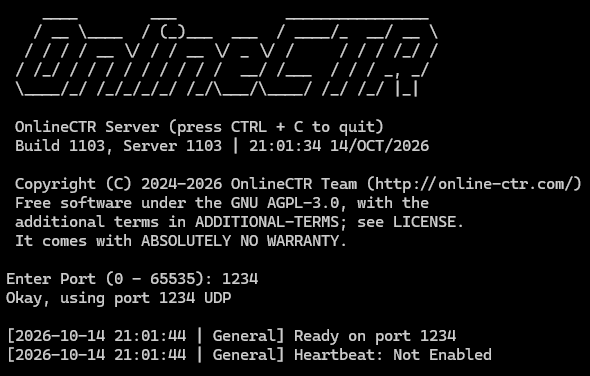

# OnlineCTR Server

Official Website: [http://online-ctr.com/](http://online-ctr.com/)

The dedicated server for OnlineCTR. Online races for Crash Team Racing on the PlayStation.
It hosts the rooms, relays the karts and weapons between the players, and referees the game modes.



### Compiling

For Windows open `Server.sln` with Visual Studio 2022 (x64). The heartbeat needs libcurl, which
vcpkg supplies from `vcpkg.json` (one-time `vcpkg integrate install`); without
vcpkg, build with `/p:OctrHeartbeat=false` and the heartbeat is left out.

For [Mingw](https://www.mingw-w64.org/)/Linux/Darwin use the `CMakeLists.txt`:

```sh
cmake -S . -B build
cmake --build build
```

The heartbeat is built when CMake finds libcurl (`libcurl4-openssl-dev` on Debian/Ubuntu).
[Nix](https://nixos.org/download/#download-nix) users can use `default.nix` or `./build-native-gcc.nix` instead.

You can also serve via Docker with the following command (run from this folder), once
`octr-server.env` exists (see Configuration):

```sh
docker compose up --build
```

### Running

```sh
./ctr_srv -p 64001
```

The port is UDP; without `-p` the server asks for one, and Enter alone takes 5501 (`DEFAULT_PORT`
in `SV_config.h`). `--banlist <file>` reads IPv4 addresses to refuse, one per line.
`--nospectate` stops players from joining a race in progress as spectators (on by default:
`SPECTATE_ENABLED` in `SV_config.h`).

### Configuration

Nothing secret is in this repository, and nothing is compiled in. Each host keeps its own
settings in `octr-server.env`, which git ignores:

```sh
cp octr-server.env.example octr-server.env
chmod 600 octr-server.env
```

Docker reads it through `compose.yml`; under systemd, point `EnvironmentFile=` at it. It sets the
heartbeat - the server's status on the site and in the launcher: the site's address, this
server's ID and its own secret (issued per server by the OnlineCTR team), and the key all
servers share for the site's "seen in the past 24h" count. With no address or no secret the
heartbeat is off and the server runs unlisted.

The server's own settings - connections per address, the lobby and race clocks, limits - are in
`SV_config.h`.

### Running on Windows Servers

Build `Server.sln` (Release, x64) from a release tag, then copy these into one folder on the server,
for example `C:\OnlineCTR`:

- `Server.exe`, `libcurl.dll` and `z.dll` from `x64\Release`
- `run.ps1` from this repository
- `octr-server.env`, made from `octr-server.env.example` (see Configuration)

The server also needs the Microsoft Visual C++ 2015-2022 Redistributable (x64), which most Windows
installs already have. Allow its UDP port through Windows Firewall once (as an administrator):

```powershell
New-NetFirewallRule -DisplayName "OnlineCTR server" -Direction Inbound -Protocol UDP -LocalPort 64001 -Action Allow
```

Then start it with your port:

```powershell
powershell -ExecutionPolicy Bypass -File C:\OnlineCTR\run.ps1 -Port 64001
```

`run.ps1` loads the settings from `octr-server.env`, the same file the Linux hosts use, and starts
`Server.exe` on that port (64001 when no `-Port` is given). With the heartbeat set up, the console
shows `Heartbeat: Enabled (updating as "<your server ID>" ...)`.

### Automatic Updates (Linux)

`autodeploy.sh` keeps a Docker host on the newest release. Every few minutes it checks GitHub for a
new release tag (`v1103`, `v1104`, ...), checks the code out at exactly that tag, and rebuilds and
restarts the server. Releases are tags, not `main`: `main` can be ahead of what players are running.

Setups that follow a branch rather than a tag (a Nix input, for example) should use `stable`: it
always points at the newest release.

Copy the script out of the server's folder and run the copy, giving it that folder. Inside the
folder, checking out an older release would delete it and a newer release would refuse to
overwrite it.

```sh
cp autodeploy.sh ~/octr-autodeploy.sh
bash ~/octr-autodeploy.sh /home/ubuntu/ctronline        # first deploy (your server folder)
crontab -e
```

Then add this line to the crontab (with your server folder):

```
*/5 * * * * flock -n /tmp/octr-autodeploy.lock bash $HOME/octr-autodeploy.sh /home/ubuntu/ctronline >> $HOME/octr-autodeploy.log 2>&1
```

- `octr-server.env` must be in the server folder first (see Configuration).
- The script runs `sudo docker compose`, so the user needs sudo without a password (Ubuntu cloud
  servers' `ubuntu` user has it). Otherwise add the user to the `docker` group and remove `sudo`
  from your copy.
- Local edits in the server folder stop the checkout: undo them with `git checkout -- .`.
- `--force` after the folder redeploys the current release.
- A deploy restarts the server, ending any races in progress.

### Versions

`global.h` is the protocol header the server shares with the game (ROM) and the PC client. It
carries two numbers. `VERSION` is the build and steps every release. `SERVER_VERSION` is what the
client and server check each other on, and steps only when a release changes the protocol: a
message struct or type in `global.h`, what the server does in reply to one, or the seats in a room
(`MAX_NUM_PLAYERS`, though no message changes size). A release that leaves `SERVER_VERSION` alone
needs no server update; every server already running keeps accepting the new client. Both show in
the server's console banner as `Build 1111, Server 1111`.

`SV_main.c` and `global.h` always come from the same release: `SV_main.c` names the protocol it
was written for (`SV_PROTOCOL`), and a `global.h` from another release refuses to build with it.

### Licence

AGPL-3.0 (`LICENSE`). ENet, bundled in `enet/`, is MIT-licensed (`enet/LICENSE`).

You must follow the license terms and additional agreement in `ADDITIONAL-TERMS`

### Credits

Engine, core, server, launcher, website and overall design overhauled in 2026 by Matt.
Special thanks to Niko. Extra thanks to ClaudioBo, BlizzrdBall and PedroHLC.

Built on [CTR-ModSDK](https://github.com/CTR-tools/CTR-ModSDK). Original Design and Source Code Copyright (C) Naughty Dog.

OnlineCTR Copyright (C) 2024-2026 OnlineCTR Team.
